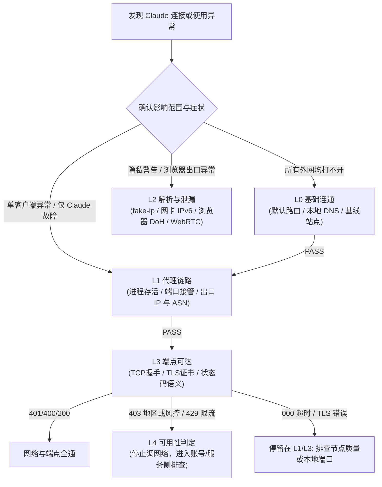

<p align="center">
  
</p>

<h1 align="center">Claude Network Environment Doctor</h1>

<p align="center">
  <b>Claude 网络环境分层体检指南与 Windows 只读诊断脚本 (L0 → L4)</b>
  <br />
  <sub>系统解耦物理连通、代理链路、DNS/WebRTC 泄漏、端点状态与账号可用性</sub>
</p>

<p align="center">
  <a href="LICENSE"></a>
  <a href="SKILL.md"></a>
  <a href="references/paths-and-commands.md"></a>
</p>

---

面向不同操作系统与代理工具的 **Claude 连通性分层诊断指南** 与 **Windows 一键只读体检脚本**。

将复杂的网络连接与账号使用门槛拆解为 **L0 至 L4 五个互不混淆的独立逻辑层**。通过逐层递进、单层定责的排查流程，彻底告别“盲目改 DNS、关 IPv6、切节点、重装代理”的无头绪试错死循环。

---

## 为什么需要这个项目？

在使用 Claude（包括网页版、Claude Code CLI 或桌面客户端）时，用户经常遇到以下棘手状况：

1. **看似“断网”，实则分流未生效**：浏览器能打开 Google，但 `claude.ai` 转圈或报错，反复切换代理节点依然无果。
2. **“网页能用，但 CLI / 桌面端报错”**：浏览器正常对话，但在终端运行 `claude` 时报连接超时或网络错误——因为 CLI 工具默认不读 Windows 系统代理（WinINET），需要显式环境变量或 TUN 接管。
3. **“状态码误判”**：一看到 `403` 就以为“节点被封”或“账号被 Ban”，实际上可能是 Cloudflare 人机验证挑战（Turnstile），或者是缺少必要的请求参数；反之，API 返回 `401` 或 `400` 恰恰证明**底层网络已经彻底打通**。
4. **过度配置与破坏性修改**：因测试网站提示“DNS 泄漏”就全局修改系统注册表、强行注销网卡驱动，反而导致局域网或其它内部服务瘫痪。

**本项目旨在建立一套客观、精确、工具无关的诊断体系，让每次排障都有明确的数据支撑与止损边界。**

---

## 核心设计哲学



1. **单层定责（One Layer, One Truth）**：
   每层只回答一个问题。上一层未通过之前，绝不跳到下一层归因。如果 L0（物理网络）没通，绝不把问题怪到节点上；如果 L3 已经拿到 HTTP 响应码，绝不回退去乱改网卡设置。
2. **客户端路径解耦（Path Specificity）**：
   明确区分 Windows 系统代理（WinINET）、L3 TUN 虚拟网卡、终端环境变量（`HTTP_PROXY` / `HTTPS_PROXY`）与各应用自身的网络栈，针对不同客户端推荐专属排查路径。
3. **无损只读排查（Zero Mutation）**：
   诊断脚本 [`doctor.ps1`](scripts/doctor.ps1) 严格遵循只读原则，仅抓取网络拓扑与响应码快照，绝不擅自覆写注册表、不强制禁用系统协议、不私自重装驱动。
4. **工具中立（Tool-Agnostic）**：
   不绑定任何特定客户端。无论是 Clash Verge Rev、Mihomo、sing-box、v2rayN、FlClash 还是各类企业级 TUN / VPN，排查逻辑与底层命令完全通用。

---

## 诊断分层模型详解 (L0 → L4)

| 层级 | 检查核心 | 关注指标 / 判据 | 典型失败表现 | 对应修复手段 |
|:---|:---|:---|:---|:---|
| **L0 基础连通** | 机器基础物理网络是否可用 | 存在物理默认路由；当地合法基线域名能解析且建立 HTTPS 连接 | 多个普通网站均打不开；网卡未获取 IP；网关丢包 | 修复物理网卡/Wi-Fi、重置 DHCP，**勿碰代理** |
| **L1 代理链路** | 目标客户端流量是否受代理接管 | 核心进程存活；系统代理/TUN/环境变量至少一项激活；出口 IP 与基线直连不同 | 出口仍等于直连基线 IP；代理未接管目标应用 | 启动代理核心；开启 TUN 或为终端配置代理环境变量 |
| **L2 解析与泄漏** | 解析与流量是否意外绕开代理 | fake-ip (`198.18.x.x`) 接管正常；网卡无未受管公网 IPv6；DoH 关闭；WebRTC 隐藏 | 浏览器出口与 `curl` 冲突；公网 IPv6 直连暴露 | 关闭浏览器“使用安全 DNS”；按需禁用网卡 IPv6 或开启 TUN |
| **L3 端点可达** | Claude 目标服务与 API 连通性 | `claude.ai` 返回 `200/30x`；`api.anthropic.com` 返回 `401/400`；`assets-proxy` 通畅 | TCP 握手超时 (000)；TLS 证书被劫持；API 拒绝连接 | 验证代理分流规则；更换网络节点；排除本地端口冲突 |
| **L4 可用性判定** | 服务可用条件与账号安全信号 | 响应体无 `unsupported_country`；出口 IP 稳定不跳变；无 Cloudflare 验证码死循环 | 明确提示地区不支持；频繁被强制登出；429 限流 | **停止调试本地网络**；转向账号权限、登录环境或官方支持渠道 |

---

## 快速上手

### 方式 A：Windows 一键只读体检快照（推荐）

项目内置了自动化诊断脚本 [`scripts/doctor.ps1`](scripts/doctor.ps1)，可在 10 秒内输出端到端的 L0-L4 体检快照：

```powershell
# 1. 完整分层体检（包含 Claude 核心端点与 API 连通性探测）
powershell -NoProfile -ExecutionPolicy Bypass -File ".\scripts\doctor.ps1"

# 2. 仅检查网络基础与代理链路（跳过 Claude 端点探测，保护隐私）
powershell -NoProfile -ExecutionPolicy Bypass -File ".\scripts\doctor.ps1" -NoClaude

# 3. 指定所在地区可访问的基线探测地址（默认 https://example.com/）
powershell -NoProfile -ExecutionPolicy Bypass -File ".\scripts\doctor.ps1" -BaselineUrl "https://example.com/"
```

#### 诊断输出范例
```text
=== Claude Network Environment Doctor ===
time=2026-11-10 18:37:22

=== L0 basic connectivity ===
L0  default route                  PASS   count=2 physical_next_hop=192.168.0.1 primary_route=198.18.0.2
L0  dns resolve (baseline)         PASS   example.com -> 198.18.2.4
L0  baseline https                 PASS   example.com=200

=== L1 proxy path ===
L1  proxy tool                     PASS   clash-verge, verge-mihomo (services: clash-verge-service)
L1  capture mode                   PASS   TUN=Mihomo
L1  curl egress ipv4               INFO   154.29.145.163 (ambient curl path; verify target client uses same route)
L1  egress geo                     INFO   US / AS979 NetLab Global

=== L2 dns and leaks ===
L2  dns for claude.ai              PASS   198.18.0.47 (fake-ip, hijacked by TUN/DNS)
L2  ipv6 egress                    PASS   none
L2  ipv6 on active NIC             PASS   TCP/IPv6 disabled on active physical adapter
L2  browser processes              INFO   msedge=15 (kill all background processes after proxy/IPv6 changes)
L2  browser DoH                    MANUAL must be OFF (toggle grey), not just another provider
L2  WebRTC leak                    MANUAL browserleaks.com/webrtc should show No Leak

=== L3 reachability ===
L3  google 204                     PASS   204 (ambient curl path)
L3  claude.ai                      PASS   200
L3  api.anthropic.com              PASS   401 (network OK, auth/params missing)
L3  assets-proxy                   PASS   http 200

=== L4 Claude readiness ===
L4  region / policy                PASS   no region block observed on API endpoint
L4  egress stability               PASS   consistent (154.29.145.163)
L4  exit quality                   PASS   non-hosting range

=== verdict ===
fail=0 warn=0
No FAIL signal in this snapshot; this does not prove every layer or client path is healthy.
```

---

### 方式 B：跨平台（macOS / Linux）与无脚本排查

无法直接运行 PowerShell 或在 macOS/Linux 环境下时，可直接参考主指南 [`SKILL.md`](SKILL.md) 配合标准命令行工具逐项验证：

```bash
# 1. 检查物理默认网关与基础解析 (L0)
ip route get 1.1.1.1
curl -s -o /dev/null -w "%{http_code}\n" -m 8 https://example.com

# 2. 验证代理出口 IP (L1)
curl -s -m 10 https://ip.sb

# 3. 验证 Claude API 端点连通性 (L3)
# 注：若返回 401 或 400，即证明网络/TLS 层已经彻底打通
curl -s -o /dev/null -w "%{http_code}\n" -m 15 -X POST https://api.anthropic.com/v1/messages -H "content-type: application/json" -d "{}"
```

---

## 客户端专项排查要点

不同客户端对代理的识别机制存在显著差异，配置时切忌一概而论：

| 客户端形态 | 代理接管依赖项 | 高频踩坑点与排查关键 |
|:---|:---|:---|
| **网页端 (Web)** | Windows 系统代理 (WinINET) 或 TUN 网卡 | 1. 浏览器内置“安全 DNS (DoH)”开关未彻底变灰，导致 DNS 解析绕过代理。<br/>2. 本地公网 IPv6 未被代理接管，形成直连旁路。<br/>3. 修改代理后，浏览器后台驻留进程（`msedge.exe` / `chrome.exe`）缓存了旧长连接。 |
| **Claude Code CLI** | 环境变量 (`HTTPS_PROXY` / `HTTP_PROXY`) 或 TUN 网卡 | 1. **默认不读取** Windows 系统代理；只开启系统代理会导致 CLI 直连失败。<br/>2. PowerShell 中使用 `setx` 仅对新开启的窗口生效，当前窗口需 `$env:HTTPS_PROXY="..."`。<br/>3. CLI 运行需完成浏览器 OAuth 授权，网页通不代表 CLI 终端通。 |
| **桌面客户端 (Desktop)** | 系统代理或 TUN 网卡（基于 Electron） | 1. 单击关闭窗口仅最小化至系统托盘，后台未退出，代理改动不生效。<br/>2. 内置网络设置若曾配置固定端口，在切换代理工具后会失效。 |

针对各类客户端的具体验证步骤与命令见 [`references/client-profiles.md`](references/client-profiles.md)。

---

## 项目结构与文档索引

```text
.
├── SKILL.md                         # 核心主指南：L0-L4 诊断流程、分流逻辑与判定准则
├── README.md                        # 项目全景说明文档（本文件）
├── scripts/
│   └── doctor.ps1                   # Windows 专用 L0-L4 一键自动化只读快照脚本
└── references/
    ├── claude-readiness.md          # Claude 核心端点语义、HTTP 状态码深度解析与可用性检查单
    ├── client-profiles.md           # Web 端 / Claude Code CLI / 桌面端差异化配置与陷阱速查
    ├── false-positives.md           # 常见检测误报纠错（如 fake-ip、分流多地区解析、机房 IP 等）
    ├── ladder-details.md            # 每层故障的跨平台命令对照表与针对性修复步骤
    └── paths-and-commands.md        # Windows 四套代理机制全景取证与主流工具配置路径速查
```

---

## 核心原则与安全边界

1. **严格只读与可观测性**：本项目仅专注于连通性排查、代理接管确认与隐私泄漏检测，绝不替用户做静默的破坏性系统修改。
2. **合规与非对抗性**：本项目**不提供**任何伪造地理位置、伪造指纹特征、规避服务条款或对抗风控系统的手段。
3. **尊重官方政策**：遇到明确的服务地区限制或账号风控拦截时，客观呈现响应体事实，引导用户通过官方支持的渠道与合规网络进行访问。
